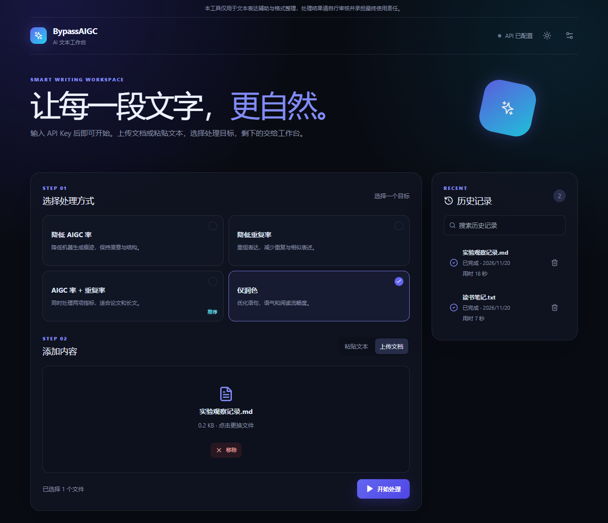
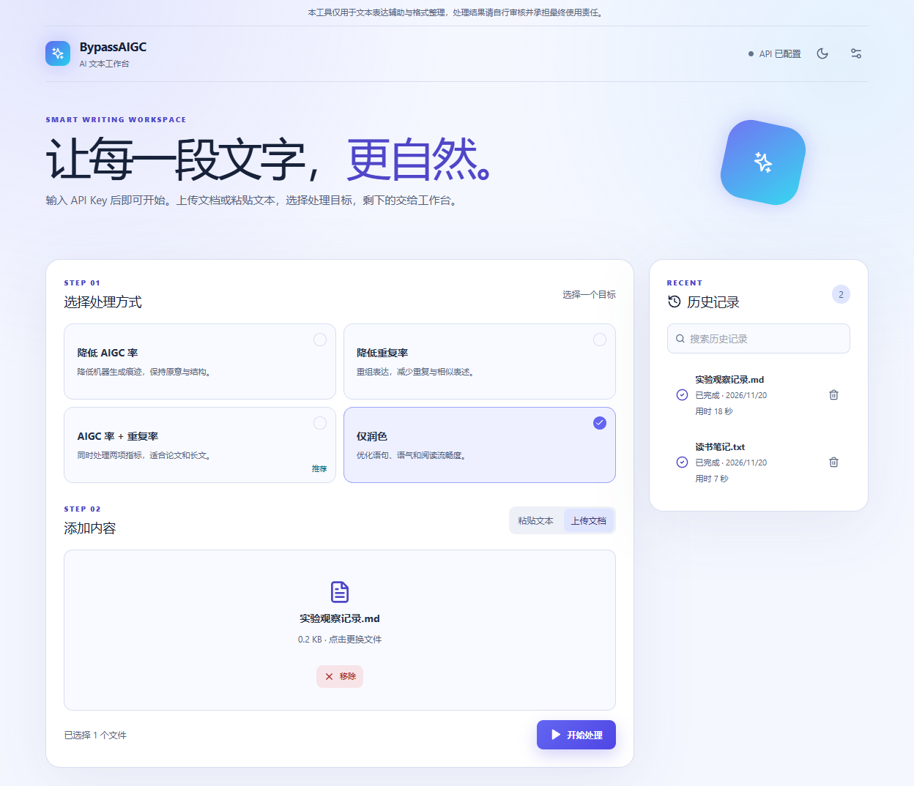
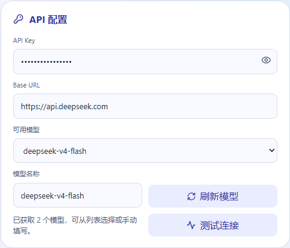
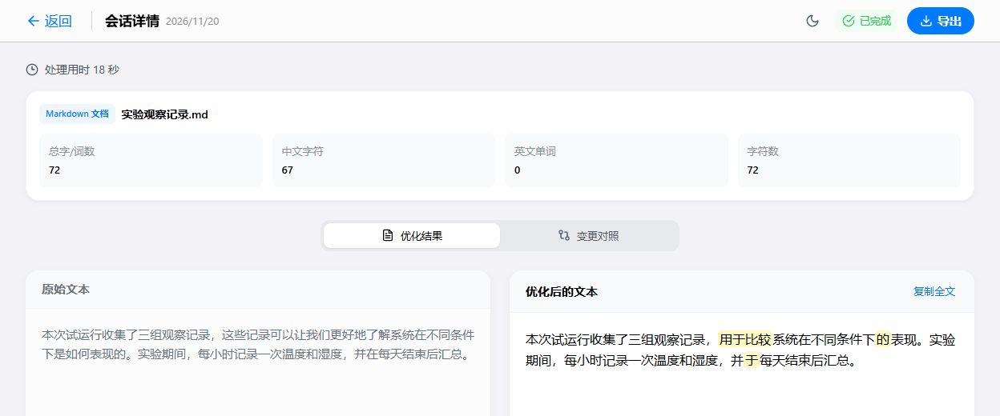

# BypassAIGC

[](https://github.com/FigureQAQ/BypassAIGC/releases)
[](https://github.com/FigureQAQ/BypassAIGC/actions/workflows/build-exe.yml)

BypassAIGC 是一个面向中文学术文章和一般长文本的本地编辑工作台。使用兼容 OpenAI API 的模型服务，润色或改写粘贴的文本和上传的文档，逐段对照修改结果，再按源文件类型导出。

[快速开始](#快速开始) · [API 配置](#api-配置) · [处理与导出](#处理与导出) · [工作目录与隐私](#工作目录与隐私) · [更新日志](CHANGELOG.md)



点击工作台或会话详情右上角的太阳／月亮图标切换主题。当前浏览器会记住选择。本文截图使用示例数据，展示的是当前分支的界面。

<details>
<summary>查看日间模式</summary>



</details>

## 快速开始

### 下载发布版

在 [GitHub Releases](https://github.com/FigureQAQ/BypassAIGC/releases) 下载并解压对应系统的包。Windows 双击 `BypassAIGC.exe`，Linux 和 macOS 可在解压目录运行 `./BypassAIGC`。程序会打开浏览器，也可手动访问 `http://localhost:9800/workspace`。

发布包以对应版本的功能为准。要试用本文展示的界面，请运行当前分支的源码。

### 从源码运行（Windows）

安装 Python 3.11、Node.js 20 和 npm，进入检出的仓库根目录后，在 PowerShell 中执行：

```powershell
.\start.bat
```

脚本会创建 Python 虚拟环境、安装依赖并启动前后端。工作台默认在 `http://127.0.0.1:5174/workspace`，后端默认在 `http://127.0.0.1:9800`。如需停止源码服务，在仓库根目录运行 `.\stop.bat`。

## API 配置

1. 点击工作台右上角的 **API 配置** 图标，填写服务商提供的 **API Key** 和 **Base URL**。若服务商提供的地址带 `/v1`，按原样填写。
2. 等待可用模型自动加载，从下拉列表选择模型。可点击 **刷新模型** 重新获取。服务商未提供模型列表时，可直接填写模型名称。
3. 点击 **测试连接** 确认所选模型可以响应。配置修改后会保存在当前浏览器。



如需设置后端默认配置，可复制 [`.env.example`](.env.example) 为 `.env`。源码版可把文件放在仓库根目录，发布版可放在程序同目录。请勿将填写了真实密钥的 `.env` 提交到版本库。

## 处理与导出

1. 选择处理方式。**仅润色**侧重语言流畅度。另外可选择降低 AIGC 率、降低重复率，或依次执行两项处理。结果需自行审核。
2. 粘贴文本，或将一个文件拖入编辑区。也可点击 **上传文档** 选择文件。
3. 点击 **开始处理**。进度卡显示处理阶段、百分比和段落进度。任务完成后，进度卡、历史记录和会话详情都会显示总用时，包含排队时间。
4. 从历史记录打开会话，核对原文和修改结果。点击 **导出**，按源文件类型下载结果。



| 输入 | 导出 | 格式说明 |
| --- | --- | --- |
| 粘贴文本、`.txt` | `.txt` | TXT 支持 UTF-8、UTF-8 BOM 和 GB18030。 |
| `.md`、`.markdown` | `.md` | 尽量保留 Markdown 结构与未修改部分的排版。 |
| `.docx` | `.docx` | 尽量保留标题、表格、图片和原始样式。 |
| `.pdf` | `.pdf` | 从可提取文本的 PDF 中读取文字，导出时重新排版。扫描件通常需要先做 OCR。 |

## 工作目录与隐私

运行时会使用本地数据库 `ai_polish.db` 记录任务。`input/`、`output/` 和 `logs/` 分别保存输入副本、输出副本和运行记录。发布版通常使用程序所在目录，源码版默认使用 `package/backend/`。可通过 `DATABASE_URL` 指定数据库位置，通过 `BYPASSAIGC_WORKSPACE_DIR` 指定输入、输出和日志所用的工作目录。

浏览器会保存 API 配置，模型请求会把需要处理的文本发送给你配置的服务商。错误报告默认留在本地。启用 `AUTO_UPLOAD_ERROR_LOGS` 后，脱敏报告会发送到配置的 `ERROR_REPORT_URL`。

## 开发与排查

- 后端健康检查 `http://127.0.0.1:9800/health`
- FastAPI 接口文档 `http://127.0.0.1:9800/docs`

后端测试（在 `package/backend/` 中运行）：

```powershell
python -m pip install -r requirements.txt pytest
python -m pytest -q
```

前端构建（在 `package/frontend/` 中运行）：

```powershell
npm ci
npm run build
```

<details>
<summary>常见错误码</summary>

| 类别 | 错误码 |
| --- | --- |
| API 配置或请求 | `E1001` 缺少配置，`E1002` 认证失败，`E1003` 请求失败，`E1004` 请求超时 |
| 文本或文档输入 | `E2001` 参数无效，`E2002` 文件类型不支持，`E2003` 文件读取或解析失败 |
| 任务 | `E3001` 任务不存在，`E3002` 任务执行失败 |
| 服务 | `E9001` 内部错误，可在 `logs/` 查看详情 |

</details>

历史版本的功能和修复见 [更新日志](CHANGELOG.md)。

## 许可证

项目采用 [CC BY-NC-SA 4.0](LICENSE) 许可。
